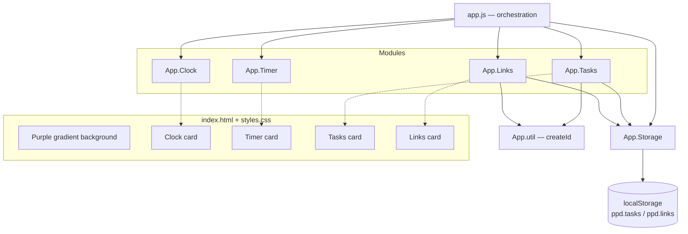
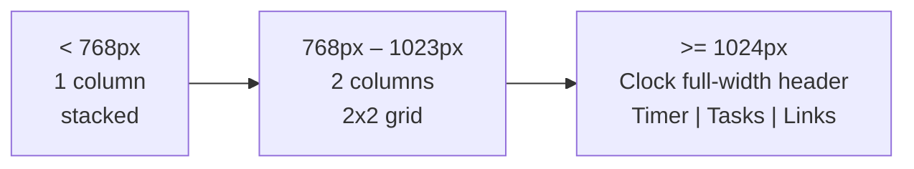
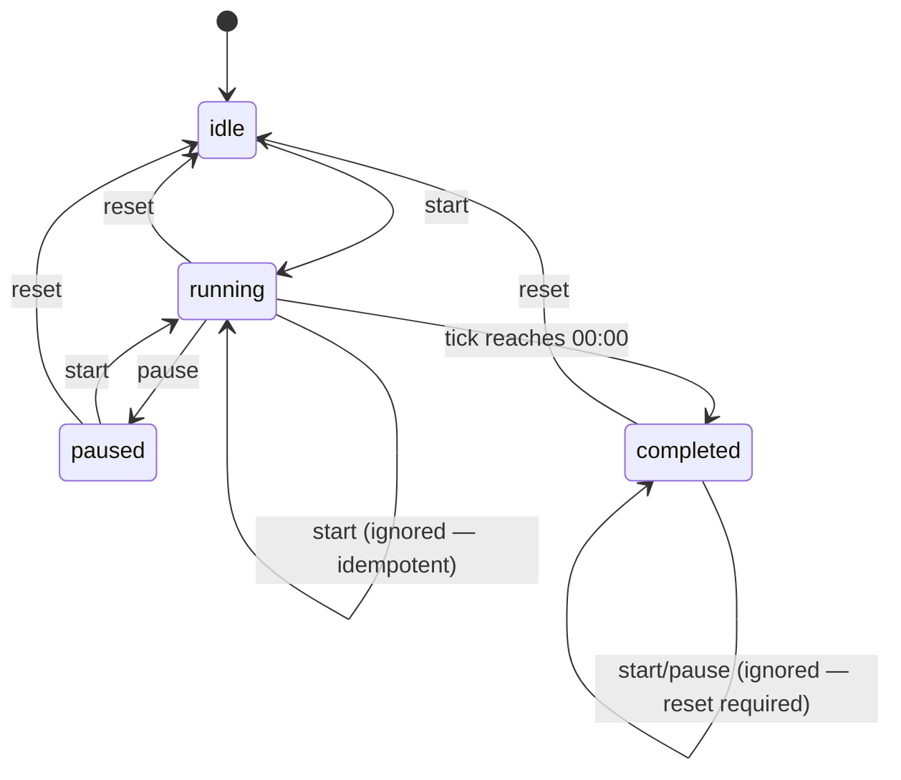

# Design Document

## Introduction

This document defines the technical design for the Personal Productivity Dashboard, a browser-based single-page application built with HTML, CSS, and vanilla JavaScript. It covers the system architecture, component interfaces, data models, correctness properties, error handling, and testing strategy for all seven requirement areas: the Digital Clock with dynamic greeting, the Focus Timer, the Task Manager, the Quick Links panel, the visual design and layout, data persistence, and browser compatibility/responsiveness.

The design favors a small, dependency-free, double-click-to-run application. Pure logic is separated from DOM and storage side effects so that the bulk of the behavior can be verified with property-based tests.

## Overview

The dashboard is a single HTML page hosting four white cards on a purple gradient background: a Digital Clock (with date and dynamic greeting), a Focus Timer, a Task Manager, and a Quick Links panel. There is no build step, no framework, and no backend. All state lives in the browser; user-created tasks and quick links persist across sessions through the browser Local Storage API.

The application is organized as a set of small JavaScript modules sharing a single global namespace (`window.App`). Each widget has two layers: a **logic layer** of pure functions (greeting selection, time formatting, validation, list mutations, serialization) and a thin **controller layer** that owns the DOM and side effects (intervals, event listeners, localStorage reads/writes). A shared storage module centralizes all Local Storage access and error handling.

### Design Goals

- **No backend, no framework, no build step.** The shipped application is plain HTML, CSS, and vanilla JavaScript. It must run when opened directly (`file://`) as well as when served statically.
- **Faithful to the requirements.** Every acceptance criterion maps to a concrete component, interface, or behavior defined below.
- **Testable core logic.** Greeting selection, time/date formatting, timer arithmetic, task/link validation, list mutations, and JSON round-tripping are pure functions isolated from the DOM so they can be exercised by property-based tests.
- **Graceful degradation.** Local Storage unavailability, quota exhaustion, and corrupt persisted data never break the session; the in-memory data survives and the user is notified.

### Key Design Decisions and Rationale

| Decision | Rationale |
|---|---|
| Classic `<script>` files + global namespace instead of ES modules | ES module imports are blocked by CORS when a page is opened via `file://`. Classic scripts run in every loading mode, so the dashboard works by double-clicking `index.html` with no server, satisfying "operate entirely in the browser without a backend server" ([MDN: script loading](https://developer.mozilla.org/en-US/docs/Web/HTML/Element/script)). |
| Pure logic layer separated from DOM controllers | Makes the behavior amenable to property-based testing and keeps controllers tiny. |
| Single shared `Storage` module with distinct keys | Centralizes JSON serialization, quota/corruption handling, and availability detection so task and link modules stay DRY and consistent. |
| Timer tracks an absolute `endTime` timestamp rather than decrementing a counter | Decoupling countdown from real wall-clock time keeps the timer accurate, self-corrects after tab-throttling, and makes pause/resume preserve remaining duration exactly (Requirements 2.5, 2.7). |
| `crypto.randomUUID()` with a fallback generator | `randomUUID()` exists in Chrome 92+, Firefox 95+, Safari 15.4+ but **only in secure contexts** (HTTPS/localhost); it is `undefined` over `file://` and plain HTTP ([MDN: Crypto.randomUUID](https://developer.mozilla.org/en-US/docs/Web/API/Crypto/randomUUID), [techearl.com](https://techearl.com/javascript-generate-uuid)). Because the app may be opened directly, IDs use `randomUUID()` when present and fall back to a timestamp+random+counter scheme otherwise, guaranteeing uniqueness in every context. |
| Store task text exactly as entered (no trimming); validate on the raw input | Requirement 3.2 says a task is created "with the entered text." Storing it verbatim keeps the serialization round-trip an identity and avoids ambiguity. Whitespace-only or empty input is rejected (3.3) and text over 200 characters is rejected with an indication (3.11). |
| Quick Link URLs normalized only at open time | Requirement 4.2 accepts any 1–2048 character string as a URL. To prevent bare hostnames like `github.com` from being treated as relative paths, the controller prepends `https://` at *open* time when no scheme is present; the stored value is unchanged. |
| Inline per-widget status messages for errors | Corrupt-data and save-failure notifications (Requirements 4.8, 6.6, 6.7) are scoped to the affected card so the user knows which widget is impacted, without a global toast framework. |
| Responsive CSS Grid driven by two breakpoints (768px and 1024px) | Matches the requirement breakpoints. Single column below 768px, two columns at tablet widths, and a full-width clock header with three columns below it on wide desktops. |

> **Note on the reference image:** The requirements state the visual layout should follow a user-provided reference image "as closely as possible" with details resolved in this phase. No image was supplied with this design, so the grid layout below is a reasonable, balanced interpretation. Card ordering and the exact desktop arrangement (clock-as-header vs. 2×2) can be tuned to the reference image during implementation without changing the component interfaces.

## Architecture

The application is a single page composed of a static HTML shell, a CSS stylesheet, and a set of vanilla JavaScript files loaded as classic scripts in dependency order. Each file attaches its module to the shared `window.App` namespace using an IIFE.

### File Structure

```
/
├── index.html          # Static shell: gradient background + 4 card containers + script tags
├── css/
│   └── styles.css      # Gradient, card styling, responsive grid, completed-task style
└── js/
    ├── util.js         # App.util — ID generation, small helpers
    ├── storage.js      # App.Storage — localStorage wrapper (save/load/availability)
    ├── clock.js        # App.Clock — time, date, greeting
    ├── timer.js        # App.Timer — focus countdown state machine + controller
    ├── tasks.js        # App.Tasks — task CRUD, validation, persistence
    ├── links.js        # App.Links — quick link CRUD, validation, persistence
    └── app.js          # App entry — DOMContentLoaded orchestration, module init
```

Scripts are included in this order so dependencies resolve: `util.js`, `storage.js`, `clock.js`, `timer.js`, `tasks.js`, `links.js`, `app.js`.

### Layered Architecture

Each widget module is internally split into two layers:

- **Logic layer** — pure functions with no DOM or storage access. These are the functions targeted by property-based tests. Example: `App.Clock.getGreeting(hour)`, `App.Timer.formatDuration(seconds)`, `App.Tasks.validateText(text)`.
- **Controller layer** — a single `init(rootElement, deps)` function per module that owns the DOM subtree, event listeners, intervals, and calls into the shared `Storage` module. Controllers are thin: they read input, call a pure function, apply the result to the DOM and/or storage, and render status messages.

The shared `App.Storage` module is the only code that touches `window.localStorage`. Task and link controllers depend on it; the clock and timer do not (they are stateless or in-memory only).

### Component Diagram



### Responsive Layout

The four cards are children of a single CSS Grid container (`display: grid; gap: <uniform>`). Card order in the DOM is Clock, Timer, Tasks, Links. Layout is driven by two media-query breakpoints:



| Viewport width | Grid columns | Arrangement | Requirement coverage |
|---|---|---|---|
| `< 768px` | `1fr` (1 column) | Clock → Timer → Tasks → Links stacked | 5.6, 7.4 |
| `768px – 1023px` | `repeat(2, 1fr)` (2 columns) | 2×2: Clock\|Timer, Tasks\|Links | 7.5 (≥768px → ≥2 columns) |
| `≥ 1024px` | `repeat(3, 1fr)`; Clock `grid-column: 1 / -1` | Clock spans full width as a header; Timer, Tasks, Links share a 3-column row | 5.5 (≥1024px → ≥2 columns) |

A single `gap` value on the grid provides uniform spacing between adjacent cards in every row and column (Requirement 5.3). The layout is pure CSS, so resizing across the 768px breakpoint reflows instantly with no reload (Requirement 7.6).

### Focus Timer State Machine

The timer is modeled as a finite state machine. Transitions are pure functions of `(state, action)`, which the controller drives from button clicks and the 1-second tick.



- `idle` shows `25:00` and is not counting.
- `running` counts down toward an absolute `endTime`; the displayed remaining time is `max(0, endTime - now)`.
- `paused` retains `remainingMs` and shows it; the interval is cleared.
- `completed` shows `00:00` plus a persistent completion indication (e.g., a "Time's up!" badge and an accent color) that remains until `reset` (Requirement 2.6).
- `start` while `running` is a no-op (Requirement 2.8, idempotent start). `start`/`pause` while `completed` are no-ops; only `reset` leaves `completed`.

## Components and Interfaces

Each module exposes pure functions (logic layer) plus a controller `init`. Pure functions are listed first; signatures use plain JS/TypeScript-style notation for clarity.

### App.util (`js/util.js`)

| Function | Signature | Description |
|---|---|---|
| `createId` | `() => string` | Returns `crypto.randomUUID()` when available; otherwise a fallback string built from `Date.now()`, a monotonic counter, and `Math.random()`. Used for unique task/link IDs. |
| `assertUnique` | `(ids: string[]) => boolean` | Helper used by tests to verify all IDs differ. |

### App.Storage (`js/storage.js`)

The only module that touches `window.localStorage`. All methods are side-effect-safe and never throw to callers.

| Member | Signature | Description |
|---|---|---|
| `KEYS` | `{ TASKS: 'ppd.tasks', LINKS: 'ppd.links' }` | Distinct Local Storage keys (Requirement 6.5). |
| `isAvailable` | `() => boolean` | Probes localStorage by a safe `setItem`/`removeItem` round-trip; returns `false` when access throws (e.g., disabled, private mode). |
| `save` | `(key: string, data: unknown) => { ok: boolean; error?: 'quota' \| 'unavailable' }` | `JSON.stringify`s `data` and calls `setItem` inside `try/catch`. Returns `{ ok: false, error: 'quota' }` on `QuotaExceededError` and `{ ok: false, error: 'unavailable' }` if storage is not available. Never mutates the caller's in-memory data. |
| `load` | `(key: string) => { status: 'ok' \| 'empty' \| 'corrupt' \| 'unavailable'; data: unknown }` | Reads the key. `null`/missing → `{ status: 'empty', data: [] }`. Valid JSON → `{ status: 'ok', data: parsed }`. `JSON.parse` throw → `{ status: 'corrupt', data: [] }`. Storage unavailable → `{ status: 'unavailable', data: [] }`. |

The `QuotaExceededError` (DOMException, code 22) is thrown both when quota is exhausted and in Safari private/incognito mode, so detection handles both cases ([TrackJS](https://trackjs.com/javascript-errors/failed-to-execute-setitem-on-storage/)).

### App.Clock (`js/clock.js`)

| Function | Signature | Description |
|---|---|---|
| `getGreeting` | `(hour: number) => string` | Pure. `5–11` → "Good Morning"; `12–16` → "Good Afternoon"; `17–20` → "Good Evening"; `21–23` or `0–4` → "Good Night" (Requirements 1.4–1.7). |
| `formatTime` | `(date: Date) => string` | Pure. 12-hour clock: two-digit hours `01`–`12` (hour 0 → `12 AM`, hour 12 → `12 PM`), two-digit minutes `00`–`59`, and an `AM`/`PM` indicator (Requirement 1.1). |
| `formatDate` | `(date: Date) => string` | Pure. Full weekday name, full month name, day-of-month, e.g. `"Monday, January 15"` (Requirement 1.2). Uses the user's local timezone (Requirement 1.10). |
| `init` | `(root: HTMLElement) => void` | Controller. Renders greeting/time/date immediately from `new Date()` (Requirement 1.9), then starts a `setInterval` of 1000 ms that re-renders from the system clock each tick (Requirements 1.3, 1.10). Recomputing from `new Date()` each tick prevents drift accumulation and self-corrects after background-tab throttling. |

### App.Timer (`js/timer.js`)

Timer state shape: `{ status: 'idle' | 'running' | 'paused' | 'completed'; remainingMs: number; endTime: number | null }`. `DEFAULT_DURATION_MS = 25 * 60 * 1000`.

| Function | Signature | Description |
|---|---|---|
| `formatDuration` | `(totalMs: number) => string` | Pure. Converts a non-negative millisecond value to `MM:SS`, e.g. `1500000` → `"25:00"`, `90000` → `"01:30"`, `0` → `"00:00"` (Requirements 1.1 timer, 2.1, 2.5). |
| `start` | `(state, now = Date.now()) => state` | Pure transition. `idle`/`paused` → `running` (sets `endTime = now + remainingMs`). `running` → unchanged (idempotent, Requirement 2.8). `completed` → unchanged. |
| `pause` | `(state, now = Date.now()) => state` | Pure transition. `running` → `paused` (sets `remainingMs = max(0, endTime - now)`, clears `endTime`). Other states unchanged. |
| `reset` | `(state) => state` | Pure transition. Any state → `idle` with `remainingMs = DEFAULT_DURATION_MS`, `endTime = null` (Requirement 2.4). |
| `tick` | `(state, now = Date.now()) => state` | Pure transition. `running` → recomputes remaining; when `now >= endTime` → `completed` with `remainingMs = 0` (Requirement 2.6). Non-`running` states unchanged. |
| `init` | `(root: HTMLElement) => void` | Controller. Renders `25:00`, wires start/pause/reset buttons, runs a 1000 ms interval that calls `tick` and re-renders, and shows the persistent completion indication while `completed`. |

### App.Tasks (`js/tasks.js`)

Task shape: `{ id: string; text: string; completed: boolean }`.

| Function | Signature | Description |
|---|---|---|
| `validateText` | `(text: string) => { valid: boolean; reason?: 'empty' \| 'tooLong' }` | Pure. `valid: true` when `text.length` is 1–200 **and** `text` contains at least one non-whitespace character. `reason: 'tooLong'` when `text.length > 200` (Requirement 3.11). `reason: 'empty'` when empty or whitespace-only (Requirement 3.3). |
| `createTask` | `(text: string, idGen = App.util.createId) => Task` | Pure. Builds `{ id, text, completed: false }` for already-validated text (Requirement 3.2, 3.10). |
| `toggleById` | `(list: Task[], id: string) => Task[]` | Pure. Returns a new list with the matching task's `completed` flag flipped (Requirement 3.5). Toggling an already-complete task leaves it complete (Requirement 3 correctness prop 2). |
| `deleteById` | `(list: Task[], id: string) => Task[]` | Pure. Returns a new list excluding the matching task; no match → unchanged list (Requirement 3.6). |
| `init` | `(root: HTMLElement, storage = App.Storage) => void` | Controller. On load, calls `storage.load(KEYS.TASKS)`; `empty`/`corrupt`/`unavailable` → start with `[]` and (for `corrupt`) show a status message (Requirements 3.9, 3.12, 6.4, 6.6). Renders the list (checkbox + text + delete button per task). On add, validates input: `tooLong` → no change + show "exceeds maximum length" indication (3.11); `empty` → no change (3.3); valid → `createTask`, append, persist, re-render. Completed tasks get a differing visual style, e.g. `text-decoration: line-through` and reduced opacity (Requirement 3.7). Every create/toggle/delete calls `storage.save`; on `!ok` it keeps the in-memory list and shows a "could not save" status (Requirements 3.8, 6.7). |

### App.Links (`js/links.js`)

Quick link shape: `{ id: string; name: string; url: string }`.

| Function | Signature | Description |
|---|---|---|
| `validateLink` | `(name: string, url: string) => { valid: boolean }` | Pure. `valid: true` when `name` is 1–100 chars with ≥1 non-whitespace char **and** `url` is 1–2048 chars with ≥1 non-whitespace char. Otherwise `valid: false` (Requirement 4.2, 4.3). No indication is shown for invalid link input — the list is simply left unchanged (Requirement 4.3). |
| `createLink` | `(name: string, url: string, idGen = App.util.createId) => QuickLink` | Pure. Builds `{ id, name, url }` for already-validated input (Requirement 4.2, 4.11). |
| `normalizeUrl` | `(url: string) => string` | Pure. If `url` matches no scheme (`/^[a-z][a-z0-9+.-]*:/i`), prepend `https://`; otherwise return `url` unchanged. Used at open time so bare hostnames open as external sites rather than relative paths. |
| `deleteById` | `(list: QuickLink[], id: string) => QuickLink[]` | Pure. Excludes the matching link; no match → unchanged (Requirement 4.6; idempotent delete prop). |
| `init` | `(root: HTMLElement, storage = App.Storage) => void` | Controller. On load, calls `storage.load(KEYS.LINKS)`; `empty`/`corrupt`/`unavailable` → start with `[]` and (for `corrupt`/`unavailable`) show a status message (Requirements 4.9, 4.10, 6.6). Renders links as clickable name text + delete button. Clicking a link opens `normalizeUrl(url)` in a new tab via `window.open(url, '_blank', 'noopener,noreferrer')` (Requirement 4.5). On add, validates; invalid → no change; valid → `createLink`, append, persist, re-render. On delete → remove, persist, re-render. Every create/delete calls `storage.save`; on `!ok` keeps in-memory list and shows a "could not save" status (Requirements 4.7, 4.8, 6.7). |

### App entry (`js/app.js`)

| Step | Description |
|---|---|
| `DOMContentLoaded` | Entry point. |
| 1. Probe storage | `App.Storage.isAvailable()`; if `false`, all widgets still run in-memory and surface status messages. |
| 2. Resolve roots | Query each card container from the static HTML. |
| 3. Init modules | Call `App.Clock.init(clockRoot)`, `App.Timer.init(timerRoot)`, `App.Tasks.init(tasksRoot)`, `App.Links.init(linksRoot)`. |
| 4. Error boundary | Wrap module init in `try/catch` so a failure in one widget does not prevent the others from initializing. |

## Data Models

### Task

The unit of the Task Manager. Serialized as an element of the `ppd.tasks` JSON array.

```typescript
interface Task {
  id: string;        // App.util.createId() — unique within the list
  text: string;      // 1–200 chars, ≥1 non-whitespace; stored verbatim (not trimmed)
  completed: boolean; // false on creation; toggled by checkbox
}
```

### QuickLink

The unit of the Quick Links panel. Serialized as an element of the `ppd.links` JSON array.

```typescript
interface QuickLink {
  id: string;   // App.util.createId() — unique within the list
  name: string; // 1–100 chars, ≥1 non-whitespace
  url: string;  // 1–2048 chars, ≥1 non-whitespace; stored verbatim, normalized only at open time
}
```

### TimerState

In-memory only; never persisted (the timer resets to 25:00 on reload).

```typescript
interface TimerState {
  status: 'idle' | 'running' | 'paused' | 'completed';
  remainingMs: number; // milliseconds left; 0 when completed; DEFAULT_DURATION_MS when idle
  endTime: number | null; // absolute Date.now() target while running; null otherwise
}
```

### Persisted Representation

Tasks and Quick Links are stored independently as JSON arrays under distinct Local Storage keys (Requirements 6.1, 6.2, 6.5):

| Key | Value | Shape |
|---|---|---|
| `ppd.tasks` | `JSON.stringify(Task[])` | `[{"id":"…","text":"…","completed":false}, …]` |
| `ppd.links` | `JSON.stringify(QuickLink[])` | `[{"id":"…","name":"…","url":"…"}, …]` |

An absent key initializes to an empty array (Requirements 3.12, 4.10, 6.4). A key whose value fails `JSON.parse` initializes the affected list to empty and triggers a user notification without affecting the other list (Requirement 6.6). A save that throws `QuotaExceededError` leaves the in-memory list intact and triggers a notification (Requirement 6.7).
